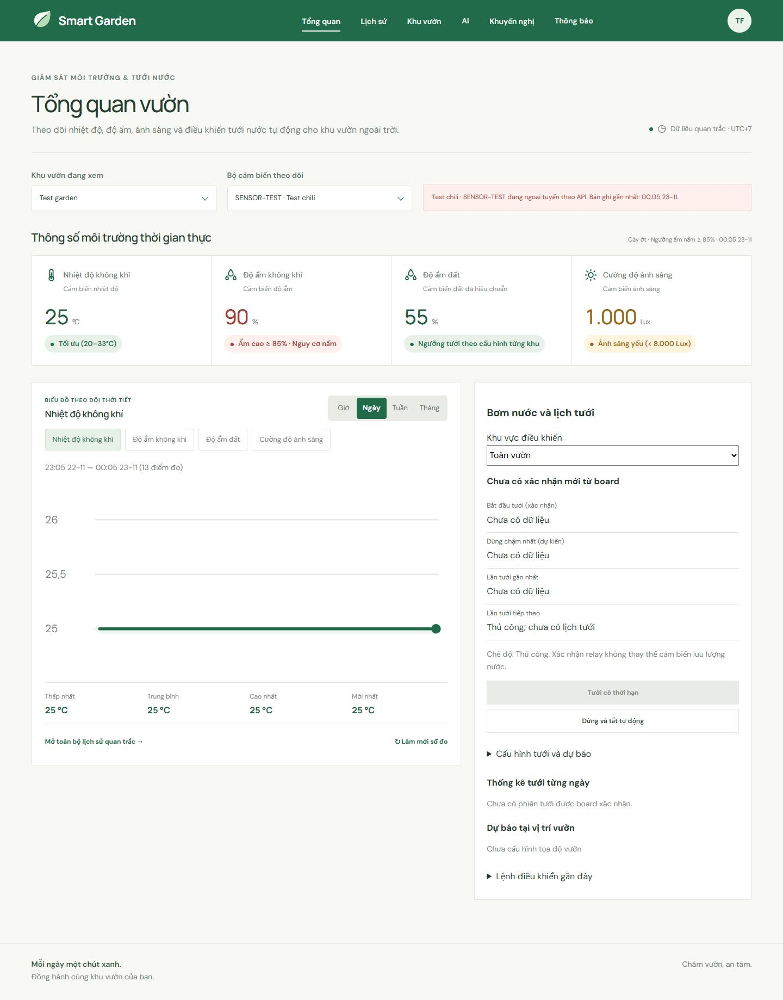

# Báo cáo AI và chức năng tưới — 23/11/2026

Đã bổ sung huấn luyện/đối chứng CatBoost và Random Forest, phục hồi độ ẩm đất trên dashboard, bổ sung cấu hình tưới theo khu, phản hồi trạng thái relay, lịch sử và thống kê tưới, tích hợp dự báo Open-Meteo. Đã loại bỏ model phân bón và pH/N/P/K khỏi luồng chức năng đang dùng.

**Chưa đủ bằng chứng để cho model điều khiển bơm.** Dữ liệu mô phỏng cho điểm tốt nhưng không chứng minh hiệu quả tại vườn. Trên bộ xà lách đo thật, cả hai model thua phương pháp giữ nguyên độ ẩm hiện tại. Vì vậy điều khiển thực tế dùng độ ẩm đất và giới hạn an toàn; trọng số AI được lưu riêng để nghiên cứu, không tự nạp vào API.

## 1. Đối chiếu phiên bản

- Bản trước đồng bộ: nhánh `codex/backup-before-sync-20261122`, commit `90fd8ef`.
- Bản GitHub đã clone/đồng bộ: `main`, commit `7bb954e`.
- Đã so sánh thay đổi frontend: bản mới chuyển sang MVC (`js/models`, `js/controllers`, `js/views`), bỏ các file tưới/camera kiểu cũ. Chức năng được bổ sung vào MVC hiện tại, không chép đè toàn bộ bằng bản backup.

| Yêu cầu | Kết quả và giới hạn |
|---|---|
| Bỏ pH/N/P/K | Xóa trọng số/loader/script phân bón. Endpoint cũ trả 410; telemetry bỏ qua trường cũ; sensor/crop response không trả các trường đã nghỉ dùng. Cột lịch sử DB được giữ để không mất dữ liệu. |
| Độ ẩm đất | Thêm ô số đo và biểu đồ bên cạnh nhiệt độ, độ ẩm không khí, lux. Ngưỡng tưới cấu hình riêng từng khu. |
| Trạng thái bơm | Phân biệt lệnh đã gửi, board xác nhận chạy/dừng, chưa có phản hồi và đang chờ dừng. Broker nhận lệnh không bị coi là bơm đã chạy. |
| Bắt đầu và dự kiến dừng | Bắt đầu từ ACK của board; thời hạn từ lệnh có giới hạn. Đồng hồ hiển thị UTC+7. |
| Lần tưới gần nhất | Từ sự kiện bật được board xác nhận. |
| Lần tưới kế tiếp | Hiển thị điều kiện đang chờ; không bịa giờ tưới khi hệ thống vận hành theo cảm biến. Chưa có model dự đoán chính xác thời điểm tưới tiếp theo. |
| Thống kê theo ngày | Đếm phiên bắt đầu, cộng thời gian có cặp ACK bật/tắt, tách qua nửa đêm. Hiển thị tối đa 7 ngày có bản ghi. Không tính lít khi chưa biết lưu lượng. |
| Môi trường hiện tại | Số đo tại vườn tách biệt dự báo ngoài trời, có thời gian cập nhật và cảnh báo thiếu dữ liệu. |
| Thời tiết | Dự báo hiện tại và hai ngày từ Open-Meteo theo tọa độ, có nguồn và thời gian cập nhật. Chưa có tọa độ thì hiển thị chưa cấu hình. |

## 2. CatBoost và Random Forest đã train gì?

### A. Dự báo độ ẩm đất sau 30 phút — dữ liệu mô phỏng của dự án

1.200 dòng; 840 train / 180 validation / 180 test, theo thời gian. Nhãn tương lai chồng ranh giới được loại nếu có. Hai model dùng cùng mẫu, đầu vào, mục tiêu; CatBoost dừng sớm theo validation, Random Forest có tham số cố định từ trước. Bộ mã hóa chỉ fit trên train. Một lần chia/seed chưa đủ kết luận thuật toán nào luôn tốt hơn.

Đầu vào: loại cây, giai đoạn, giá thể, diện tích, độ ẩm đất hiện tại, nhiệt độ, độ ẩm không khí, **ánh sáng lux**, lượng nước dự kiến cấp (lít). Đầu ra: độ ẩm đất sau 30 phút. Không dùng pH/N/P/K, bức xạ mặt trời, hoặc thông tin tương lai làm đầu vào.

| Model | MAE (điểm % độ ẩm) | RMSE (điểm %) | R² |
|---|---:|---:|---:|
| CatBoost | 0,7284 | 0,8905 | 0,9968 |
| Random Forest | 0,9553 | 1,2048 | 0,9941 |
| Giữ nguyên độ ẩm hiện tại | 1,8253 | 2,2990 | 0,9784 |

MAE theo cây: CatBoost ớt 0,7452; xà lách 0,7115. Random Forest ớt 0,8899; xà lách 1,0206. Đây là tên cây trong công thức sinh dữ liệu, **không phải kiểm định trên cây thật**. MAE 0,73 điểm % không có nghĩa accuracy 99,27%.

### B. Xà lách đo thật — dự báo độ ẩm sau một giờ

Nguồn: [Mendeley v2, DOI 10.17632/294zk6k5wf.2](https://data.mendeley.com/datasets/294zk6k5wf/2), CC BY 4.0; Georgios Fevgas, Thomas Lagkas, Vasileios Argyriou, Panagiotis Sarigiannidis. Đã tải CSV 145 dòng cho hai cây qua sáu ngày. Một cây được tưới, một cây bị ngừng tưới. Không tải toàn bộ ảnh để tránh chiếm ổ đĩa không cần thiết.

Đầu vào: độ ẩm hiện tại, độ ẩm giờ trước, sin/cos giờ. Đầu ra: số đo kế tiếp cách 55–65 phút. 198 dòng train / 40 validation / 44 test sau ghép hai cây, tạo lag và loại chồng nhãn. Cùng mốc thời gian chia cho cả hai cây, không đưa ID cây vào model.

| Model | MAE (điểm %) | RMSE (điểm %) | R² | Dự đoán lệch ≤5 điểm % |
|---|---:|---:|---:|---:|
| CatBoost | 20,8604 | 29,6967 | -0,1246 | 50% |
| Random Forest | 20,3861 | 28,9612 | -0,0696 | 50% |
| Giữ nguyên độ ẩm hiện tại | **0,5909** | **0,9535** | **0,9988** | **100%** |

Cả hai cây quyết định hồi quy ngoại suy kém ở giai đoạn độ ẩm giảm trong test. Bộ dữ liệu quá ngắn, thiếu lượng nước, nhiệt độ, lux, mưa và khu độc lập. Treatment “có tưới/không tưới” không phải nhãn “nên tưới/không nên tưới”. **Không triển khai hai trọng số này vào điều khiển.** Không dùng kết quả xà lách để tuyên bố độ chính xác trên ớt.

### C. Đối chứng phụ với SIO mô phỏng công khai

[SIO, commit fb421ab52d070cb9dce6c2db28d0f95fcec96105](https://github.com/Abijith-U0245/SIO---Smart-Irrigation-Optimization/tree/fb421ab52d070cb9dce6c2db28d0f95fcec96105): 2.000 dòng, tám loại cây; **không có ớt/xà lách**. Chia ngẫu nhiên có cân bằng nhãn 1.400/300/300 do không có timestamp. Mỗi cấu hình dùng đúng cùng test cho hai thuật toán; không trộn hai đầu ra vào features của nhau.

| Đầu vào | CatBoost đúng quyết định tưới | RF đúng quyết định tưới | CatBoost MAE nước (mm) | RF MAE nước (mm) |
|---|---:|---:|---:|---:|
| Cây/giai đoạn/ẩm đất/nhiệt độ/ẩm không khí | 88,00% | 87,67% | 9,2086 | 9,3297 |
| Thêm mưa 7 ngày + bức xạ mặt trời | 94,67% | 92,67% | 2,9334 | 5,4442 |

Baseline chọn lớp đa số: 64%; đoán lượng nước theo trung vị train: MAE 20,8496 mm. Nhãn tưới trong file tương ứng điều kiện lượng nước >25 mm trên toàn bộ dòng; đây không phải ngưỡng được kiểm chứng cho vườn của nhóm. Không được thay bức xạ MJ/m² bằng lux. Bản CSV gốc có pH nhưng script loại khỏi input. Không thấy giấy phép rõ ràng nên không đưa CSV hoặc trọng số SIO lên Git; chỉ lưu nguồn, script và báo cáo.

## 3. Dataset hiện có và nguồn còn thiếu

- `Greenhouse_Demo_Dataset.xlsx`: 2.500 dòng, gồm pH/N/P/K, chẩn đoán và hành động bón phân; thiếu thời gian, lux, lượng tưới và số đo đất sau tưới. Không thể biến nhãn phân bón thành nhãn tưới đúng bằng đổi tên cột.
- `chili_plant_disease`: 500 ảnh train/validation/test phục vụ bệnh lá. Ảnh không chứa nhãn thể tích, thời điểm tưới hay phản ứng đất nên không dùng để train CatBoost/RF tưới.
- MobileNetV2 bệnh lá 224×224 được giữ ở một vị trí chuẩn; chưa có báo cáo đánh giá độc lập. CNN nhỏ 160×160 giữ kết quả cũ: accuracy 70%, macro-F1 khoảng 0,6766 trên 50 ảnh test, lớp leaf spot recall 30%. Không train lại CNN trong đợt này, không dùng điểm bệnh lá như điểm tưới.
- Nguồn chili/papaya MCMD [10.17632/z8mhg4hfpc.2](https://data.mendeley.com/datasets/z8mhg4hfpc/2) cũng là ảnh bệnh lá.
- Tìm được dữ liệu tưới/khí hậu thí nghiệm ớt ngọt xen canh trong nhà màng, [bài báo](https://pmc.ncbi.nlm.nih.gov/articles/PMC10562147/) và [DOI 10.57745/QXZRDX](https://entrepot.recherche.data.gouv.fr/dataset.xhtml?persistentId=doi:10.57745/QXZRDX). File phù hợp tiềm năng là `04_Irrigation_soil_water_tension_and_climatic_condition.csv`, nhưng kho dữ liệu trả trang bảo trì lúc truy cập. **Chưa tải/kiểm chứng/train nguồn này.** Tension kPa cũng không tương đương độ ẩm % của cảm biến nhóm.

Kết luận: đã train cả hai thuật toán trên dữ liệu đủ cột cho từng bài toán thử nghiệm, nhưng **chưa có dataset ớt và xà lách đủ nhãn để học lịch tưới tối ưu**. Không bịa dữ liệu để tuyên bố hoàn tất phần này.

## 4. Dự báo thời tiết và điều chỉnh tưới

Dự báo ngày nóng/mưa lấy từ [Open-Meteo Forecast API](https://open-meteo.com/en/docs), không phải CatBoost tự dự đoán khí hậu từ một số đo tại vườn. Timeout 4 giây, cache thành công 15 phút, lỗi 1 phút. Chỉ gửi tọa độ và tham số thời tiết công khai, không gửi số đo/account của nhóm.

- Sáng 04:00–trước 10:00 theo múi giờ vườn, nếu nhiệt độ cực đại dự báo hôm nay đạt ngưỡng: nhân thời lượng cơ sở với hệ số sáng.
- Từ 16:00, nếu ngày mai đủ xác suất và lượng mưa, **chỉ khu nhận mưa trực tiếp** được giảm theo hệ số chiều. Không áp dụng giảm mưa cho nhà kính kín.
- Mặc định hệ số đều bằng 1, ngưỡng nóng 35°C, mưa 70% và 5 mm; đây là cấu hình ban đầu, không phải ngưỡng chuẩn cho mọi cây.
- Đất phải khô dưới ngưỡng bật và vượt qua tất cả kiểm tra trước khi bắt đầu. Ngưỡng dừng cao hơn ngưỡng bật để tránh bật/tắt liên tục.
- Luôn chặn thời lượng ở mức tối đa; dự báo lỗi thì không tự tăng/giảm. Có thể đặt khung giờ, giới hạn nhiệt độ và lux riêng cho khu.
- Hiện điều chỉnh **thời lượng**, chưa cam kết lượng nước lít vì chưa đo lưu lượng. Không khẳng định mọi hình thức tưới lúc nắng đều làm hại cây; loại tưới, vùng rễ và điều kiện cây phải được xét thực tế.

## 5. Luồng điều khiển và bảo vệ

1. Thiết bị gửi token, timestamp có múi giờ, nhiệt độ, ẩm không khí, ẩm đất và lux. Thiết bị phải ACTIVE, đúng loại và đúng khu.
2. API từ chối thiếu trường, NaN/ngoài khoảng, tương lai quá 5 giây, cũ quá 120 giây, sai thứ tự; bản tin trùng không tạo lệnh mới. Kiểm tra nhảy số và số đo kẹt trước khi tưới.
3. Kiểm tra khóa tưới, hiệu chuẩn/phần cứng đã xác nhận, cùng khu cảm biến–bơm, thời gian nghỉ, giờ cho phép, ngân sách 24 giờ và ngưỡng đất.
4. Lệnh có device/garden cụ thể, UUID, token, hạn nhận 10 giây và lease tối đa 120 giây. Board từ chối phát lại; không kéo dài lease khi nhận trùng.
5. Gửi MQTT thành công mới ghi trạng thái mong muốn; UI chờ ACK riêng của board. Không xem PUBACK là nước đang chảy.
6. Tiến trình worker kiểm tra mỗi 2 giây để dừng khi hết hạn hoặc dữ liệu không còn hợp lệ, kể cả không có gói cảm biến mới. Dừng thất bại được giữ để thử lại.
7. Firmware tắt relay khi khởi động/mất mạng và tự ngắt bằng timer. Nút dừng thủ công tắt cả AUTO; luôn cho phép yêu cầu dừng dù dữ liệu đất lỗi.

ACK chỉ chứng minh board báo trạng thái relay, không chứng minh bơm/lưu lượng hoạt động. Firmware chưa được biên dịch, nạp hoặc kiểm nghiệm trên mạch thật. `HARDWARE_VERIFIED=false` mặc định; hàm đọc đất/lux trả thiếu dữ liệu cho đến khi nối đúng cảm biến và hiệu chuẩn. ESP8266 chỉ có một A0, không thể tự suy ra cách nối đồng thời LDR và cảm biến đất. Cần xác nhận loại board, chân, relay và ADC mở rộng nếu dùng.

## 6. Database và kiểm thử

Đã áp dụng `20261118_outdoor_garden_multimodal_actuators.sql` và `20261123_irrigation_feedback.sql` vào database cấu hình của dự án trong một giao dịch. Migration bổ sung cột/bảng, không seed hoặc xóa dữ liệu. Đối chiếu sau chạy: không còn thiếu cột được khai báo trong SQLAlchemy models. Không bật worker hoặc bơm thật trong quá trình kiểm tra.

Migration mới thêm trạng thái board, thời điểm ACK, thời lượng và index lịch sử; mặc định bơm mới là MANUAL. Người khác dùng cùng Neon không cần chạy lại chỉ vì clone; database riêng phải áp dụng các migration nền trước, sau đó dùng script kiểm tra/ap dụng migration mới.

- **37 kiểm thử API pass** với SQLite riêng, MQTT tắt/mock: xác thực, API, model training, dữ liệu không hợp lệ, timeout khi không có bản tin, cooldown, budget, khu sai, ACK, publish thất bại, split ngày, tưới AUTO có cap và dừng đất ướt.
- **9 kiểm thử frontend pass**; JavaScript kiểm tra cú pháp.
- Trình duyệt thật: 1440, 768, 390 px không tràn ngang; số đo đất, panel bơm hiển thị; lưu cấu hình thông qua API thành công; không lỗi JavaScript; không giả hiển thị đang tưới.
- Kiểm thử không thay cho thử nghiệm PostgreSQL đồng thời tải cao hoặc kiểm tra firmware/phần cứng. Không đo độ chính xác AI trên vườn của nhóm.



## 7. Chạy lại và sử dụng

Trong `D:\PBL4\api`, dùng môi trường Python của dự án:

```powershell
.\venv\Scripts\python.exe -m pip install -r requirements-irrigation.txt
.\venv\Scripts\python.exe -m scripts.train_irrigation_model --demo
.\venv\Scripts\python.exe -m scripts.benchmark_lettuce_moisture
.\venv\Scripts\python.exe -m scripts.benchmark_sio_irrigation
```

Script tải hai nguồn công khai nếu chưa có và kiểm checksum. Mỗi lần train tạo thư mục thời gian mới trong `api/ml_models/irrigation/` (Git bỏ qua). Trọng số đã train của bài mô phỏng và xà lách nằm trong `api/ml_models/research/`, kèm manifest checksum/phiên bản thư viện. Báo cáo JSON và dự đoán test nằm cùng báo cáo này. Không đưa dữ liệu thí nghiệm SIO không rõ giấy phép lên repo.

Kiểm tra/ap dụng migration cho database đã có cấu trúc nền:

```powershell
.\venv\Scripts\python.exe -m scripts.apply_irrigation_migrations
.\venv\Scripts\python.exe -m scripts.apply_irrigation_migrations --apply
```

Sau khi cấu hình `.env` riêng, mở API và frontend theo README. Trong dashboard chọn đúng khu, board và cảm biến; đặt ngưỡng đã hiệu chuẩn, giới hạn, tọa độ, có/không nhận nước mưa. Chỉ sau khi thử relay với nguồn bơm ngắt và kiểm chứng tự ngắt, mới xác nhận phần cứng, chọn AUTO và chạy **một** tiến trình:

```powershell
.\venv\Scripts\python.exe -m app.irrigation_worker
```

Để cải thiện AI: thu cặp số đo trước–sau tưới, lượng nước thật, loại cây/giai đoạn, giá thể, lux, nhiệt độ, ẩm, vùng rễ và mưa; dùng template và hướng dẫn trong `api/README.md`. Cần nhiều chu kỳ/ngày và khu kiểm tra độc lập. Chạy dự báo song song trước, không dùng test để chỉnh model liên tục và không chuyển sang điều khiển chỉ vì điểm mô phỏng cao.
